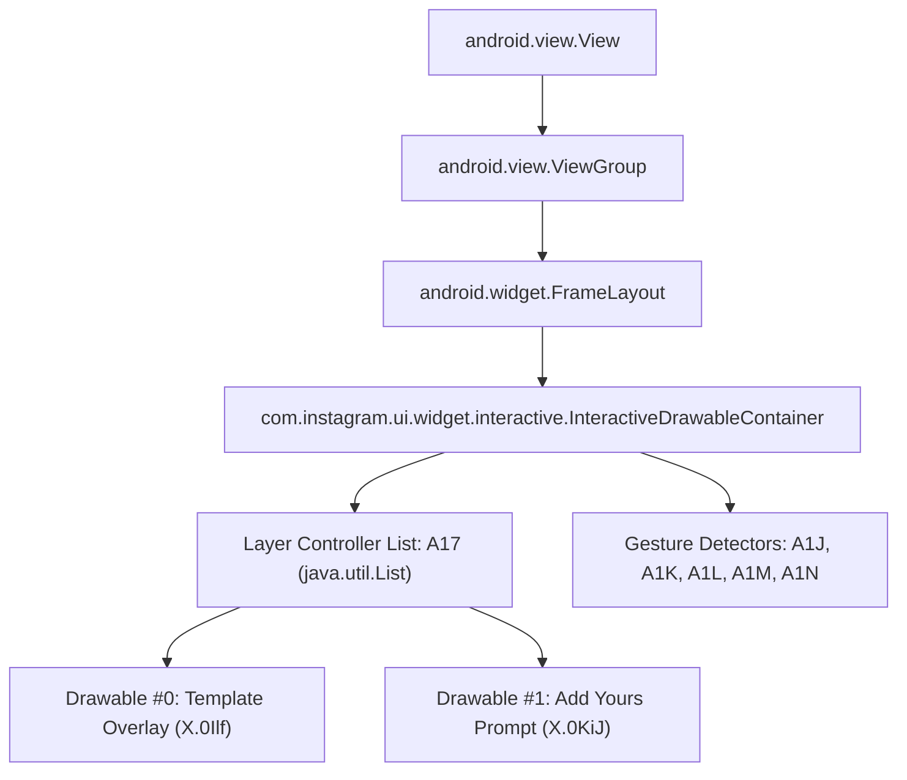

# Phase 7 — Stage 1: Touch Dispatch & Event Flow Analysis

## 1. Overview & Objective
This report details the runtime touch event flow within Instagram Story Editor (`v450.0.0.50.77`) on LDPlayer 9, specifically focusing on `com.instagram.ui.widget.interactive.InteractiveDrawableContainer` and the layer controller `X.0Hj5` managing `STORIES_TEMPLATE_GALLERY_OVERLAY`.

The goal is to determine the optimal, safe interception point for interactive dragging without breaking existing sticker interactions or camera gesture routing.

---

## 2. Component Class Hierarchy & Structure

* **Target View**: `com.instagram.ui.widget.interactive.InteractiveDrawableContainer`
* **Superclass**: `android.widget.FrameLayout`
* **Display Coordinates**:
  * Host Screen Size: `1600 x 900` px (LDPlayer landscape tablet configuration).
  * Story Editor Container: Centered at `X = 548, Y = 2`, dimensions `504 x 896` px.
  * Local Coordinates in `InteractiveDrawableContainer`: `[0..504, 0..896]`, center at `(252, 448)`.

---

## 3. Touch Event Dispatch Pipeline

Using Frida dynamic instrumentation (`hooks/touch_diagnostics.js`), we observed the exact runtime dispatch sequence for touch events:

### 3.1 Pre-Capture Mode (Camera Viewfinder)
1. **Window / DecorView Dispatch**: Raw screen touches enter `TransparentModalActivity`.
2. **Camera Interceptor Layer**: In pre-capture mode, vertical swipe gestures (`ACTION_MOVE` with `|dy| > threshold`) are intercepted by the camera gallery drawer and filter selector before reaching `InteractiveDrawableContainer`.
3. **Container Interception**: `InteractiveDrawableContainer.onInterceptTouchEvent` returns `false` for taps, but camera gesture detectors consume vertical drag events.
4. **Key Finding**: Pre-capture mode is hostile to raw touch drag hooks because camera mode transitions take precedence over canvas drawables.

### 3.2 Post-Capture Mode (Story Editor Canvas)
1. **`dispatchTouchEvent(MotionEvent ev)`**:
   * Evaluates child views. If no child views consume the event (all stickers are rendered directly on the canvas as drawables, not child Views), dispatches to `super.dispatchTouchEvent(ev)`.
2. **`onInterceptTouchEvent(MotionEvent ev)`**:
   * Returns `false`. `InteractiveDrawableContainer` manages stickers internally rather than intercepting child view touches.
3. **`onTouchEvent(MotionEvent ev)`**:
   * Primary entry point for all sticker interactions.
   * On `ACTION_DOWN`: Evaluates hit tests across controllers (`A17`).
   * Internal `GestureDetector` instances (`A1J..A1M`) receive events (`onDown`, `onScroll`, `onFling`, `onLongPress`).
   * Returns `true` to establish pointer capture for the entire gesture stream (`ACTION_MOVE*`, `ACTION_UP`).

---

## 4. Hit Testing & Controller Activation in `X.0Hj5`

### 4.1 Native Hit Testing Method: `int AeU(float x, float y)`
* Runtime testing confirmed that each `X.0Hj5` controller exposes `AeU(float x, float y)`.
* When evaluated on the template controller:
  * Center `(504, 736)` -> returns `0` (HIT).
  * Boundary `(0, 0)` -> returns `-1` (MISS).
* **Limitation of Native `AeU`**:
  `AeU` evaluates the **entire 504x896 bitmap bounding box** (`Field A0w: RectF(252, 288, 756, 1184)`). Because the template bitmap is transparent everywhere except the nameplate banner, relying on `AeU` would cause touches anywhere on the screen to grab the template layer, blocking clicks on the prompt sticker ("Còn bạn?") or other elements.

### 4.2 Required Hit Testing Architecture (Stage 2)
To allow independent dragging of the nameplate while preserving the "Còn bạn?" sticker:
* Use a **sub-rectangle hit test** mapped from the original 720x1280 asset bbox `(124, 346, 597, 535)`.
* Scale to current container size: `scale = container.getWidth() / 720.0 = 504 / 720 = 0.7`.
* Offset by active controller center:
  $$\Delta X = \text{hj.CzU}() - \frac{\text{width}}{2}$$
  $$\Delta Y = \text{hj.CzV}() - \frac{\text{height}}{2}$$
* Active Hitbox:
  $$\text{Hitbox} = \text{RectF}(124 \cdot s + \Delta X, \; 346 \cdot s + \Delta Y, \; 597 \cdot s + \Delta X, \; 535 \cdot s + \Delta Y)$$
* Only when a touch falls inside this exact `Hitbox` does our hook capture the gesture.

---

## 5. Conclusion & Hook Insertion Point
* **Optimal Hook Target**: `InteractiveDrawableContainer.onTouchEvent(MotionEvent ev)`
* **Interception Rule**:
  * On `ACTION_DOWN`: If inside active nameplate hitbox, consume (`return true`), enter `DRAGGING` state, suppress standard Instagram sticker selection.
  * On `ACTION_MOVE`: If in `DRAGGING` state, translate touch delta directly to `hj.HC7()` and `hj.HC8()`, request redraw, and consume (`return true`).
  * On `ACTION_UP` / `ACTION_CANCEL`: Exit `DRAGGING` state, preserve final position, and consume (`return true`).
  * If NOT in `DRAGGING` state: Delegate unconditionally to `this.onTouchEvent(ev)` to keep all native Instagram controls completely unmodified.
